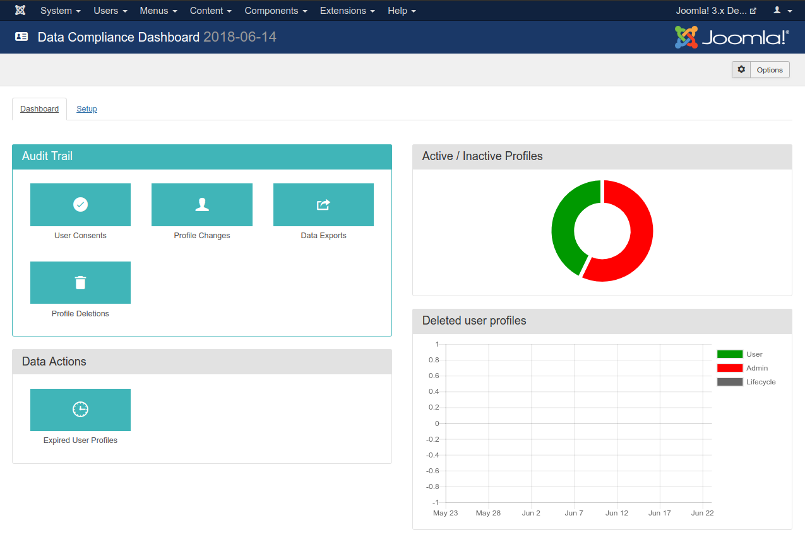

# Dashboard (a.k.a. Control Panel) page

_The Dashboard page_

This is the main backend page of Data Compliance. It allows you to quickly access its features.

The top part of the page is Joomla's toolbar. Clicking on the Options button will take you to the [component
configuration page](configuration.md#component-config).

There is a tab bar below the toolbar. This lets you view the [Email Templates](email-templates.md) setup page and get
back to the Dashboard.

The buttons in the left hand side of the main are of the page allow you to access the various logs and management
features of Akeeba Data Compliance. They are covered further ahead in this documentation.

The right hand site contains a set of graphs for quick overview of actions taken with Akeeba Data Compliance.

The **Active / Inactive Profiles** doughnut chart gives you a quick glance of the user profiles status on your site.
Active (non-expired) profiles are shown in green. [Expired profiles](data-actions.md#expired-profiles) which have not
been deleted are shown in red. Expired profiles which have already been deleted are shown in grey. To conform with the
GDPR data minimisation rules the red area of this graph needs to be minimised and converted to grey. Not all red can
disappear: some expired profiles are not allowed to be deleted according to the rules applied by the Data Compliance
plugins, e.g. you can't remove Super User accounts even if they haven't logged into your site in years.

The **Deleted User Profiles** stacked bar chart gives you more insight into when and how user profiles have been
deleted. For each day on the last calendar month you will see a stacked bar with the number of profiles deleted on that
day. Profiles deleted by the users themselves are shown in green. Profiles deleted by an administrator are shown in red.
Profiles deleted automatically, using the [lifecycle policy CRON job](data-minimization.md) are shown in grey.
