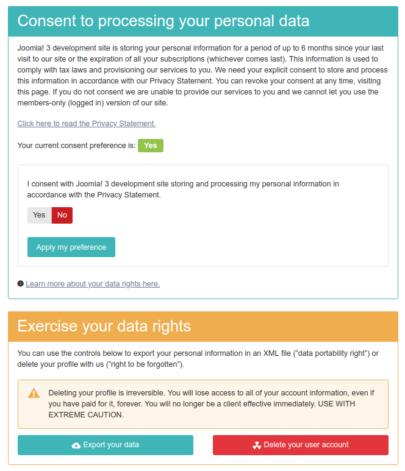

# Self-service page

The self-service page is where the users can manage their consent to your processing their Personally Identifiable
Information (PII), export their PII in a machine readable format or remove their user profile.

_The self-service page_

## How to get there?

There are several ways to get to that page.

If you have enabled Data Compliance's User plugin, you can edit your Joomla! user profile using the built-in Joomla!
Users component. Please note that this method does not work with third party extensions which implement their own user
profile, such as Community Builder. When a user is editing their profile they will see a **Manage your personal data
options** link. Clicking on it leads you to the self-service page. This also applies in the backend of the site.

If you are a Super User you can click edit any user's profile and you will see the same link. This will take you to the
same page with a slightly different interface: it will tell you which user's personal data preferences you are managing
and you won't be able to change their consent settings (because it's disallowed by the GDPR).

Finally, you can create a Joomla frontend menu link to that page from Joomla's menu manager. It is recommended that you
put this on your site's footer or the site's user menu (if applicable) to let users find their personal data options
page more easily, fulfilling the GDPR requirement for easy access to the options to exercise your data rights.

## Managing the consent

The top half of the self-service page allows you to manage your consent for processing the personal data. You can see
the current setting for the consent preference and the controls to change it. Please note that the default option in the
controls is always set to No, per the GDPR requirement for explicit action to provide consent. If you want to give your
consent set it to **Yes**, then click on **Apply my preference**. Conversely, if you want to revoke your consent set
this to **No** and then click on **Apply my preference**.

Above the controls there is a link which reads **Click here to read the Privacy Statement**. Clicking on it opens a
slider with the Privacy Statement article, as selected in the component's Options page.

Below the controls there is the **Learn more about your data rights here** link. This opens a new browser tab or window
to the European Union portal for Data protection. This link should not be removed as you are required by GDPR to provide
a link to this or a similar resource to your users.

## Exporting the PII

The bottom half section of the self-service page has two buttons. The first button allows you to export your user
profile in a common, machine-readable format (XML). This lets you exercise your Data Portability Rights under the GDPR.
Click on **Export your data** to download an XML file to your computer. This contains all the PII about you which is
currently known to Akeeba Data Compliance through its plugins.

## Deleting the user profile

The bottom half section of the self-service page has two buttons. The second button allows you to wipe your user
profile. Depending on the options made in the various Akeeba Data Compliance plugins this will either completely remove
or at the very least completely pseudonymize the PII stored on record for you on the site. Please note that this process
is **irreversible**. Furthermore, once it's complete it will be impossible to restore your user account and its PII.
Therefore, clicking the **Delete your user account** button exercises your Right To Be Forgotten under the GDPR.

Sometimes it's not possible to exercise your right to be forgotten. This depends on the settings of the various Akeeba
Data Compliance plugins. For example, people belonging to a privileged group (by default: Super Users) or who have
bought a subscription within the last few days may be denied this right. You are told exactly why deletion is not
possible through a standard Joomla error message. Having an administrator of the site resolve that condition is
necessary before wiping the user account is possible. Administrators should look at the settings of the various Akeeba
Data Compliance plugins to understand why the deletion is prevented.

If the deletion can proceed you are taken to the confirmation page. Here you are informed that the deletion is
irreversible. Moreover, all the steps which will be carried out by Akeeba Data Compliance are explicitly stated. These
bullet points come from the various Akeeba Data Compliance plugins. You are also informed about the information which
exists outside the scope of Joomla and which cannot be deleted by Akeeba Data Compliance. At the bottom of the page you
are asked to type a phrase (“_I UNDERSTAND_” in all caps) and click on the **DELETE MY USER ACCOUNT** button. This is
your last chance to abort! Navigate anywhere else or close the browser tab to abort. If the phrase was entered correctly
and the button is clicked the user account is wiped forever and can not be restored.

## Customization of the page

Akeeba Data Compliance uses Joomla! view templates which follow [FOF 3's Blade template language
syntax](https://github.com/akeeba/fof/wiki/Blade-Templates). You can use [standard Joomla template
overrides](https://docs.joomla.org/How_to_override_the_output_from_the_Joomla!_core) to modify the look, feel, and
functionality of this page. By default, the HTML structure follows Bootstrap and our own custom CSS, providing a unified
look and feel for all of our extensions. If you need to use a different template framework you will have to do template
overrides.

> [!IMPORTANT]
> Do not change the URLs, the hidden fields, or remove form elements when doing overrides. This could cause Akeeba Data
> Compliance to behave erratically with your overrides.
>
> You may remove or change static links, i.e. the link to "Learn more about your data rights".
>
> Do NOT make template overrides to modify the text on the page. Use [language
> overrides](https://docs.joomla.org/J3.x:Language_Overrides_in_Joomla) instead.

The view template files you need to override is located in:

`PATH_TO_JOOMLA/components/com_datacompliance/tmpl/Options/default.blade.php` The self-service page

`PATH_TO_JOOMLA/components/com_datacompliance/tmpl/Options/wipe.blade.php` The confirmation page for wiping your user
account

You can create frontend (public site) overrides for these files in:

`PATH_TO_JOOMLA/templates/YOUR_TEMPLATE/html/com_datacompliance/Options/default.blade.php` The self-service page

`PATH_TO_JOOMLA/templates/YOUR_TEMPLATE/html/com_datacompliance/Options/wipe.blade.php` The confirmation page for wiping
your user account

You can create backend (administrator) overrides for these files in:

`PATH_TO_JOOMLA/administrator/templates/YOUR_TEMPLATE/html/com_datacompliance/Options/default.blade.php` The
self-service page

`PATH_TO_JOOMLA/administrator/templates/YOUR_TEMPLATE/html/com_datacompliance/Options/wipe.blade.php` The confirmation
page for wiping your user account

Please note that Blade templates are compiled and cached as PHP view templates. If you do not see your changes taking
effect please go to your site's backend, Cache and clear your frontend or backend cache.
